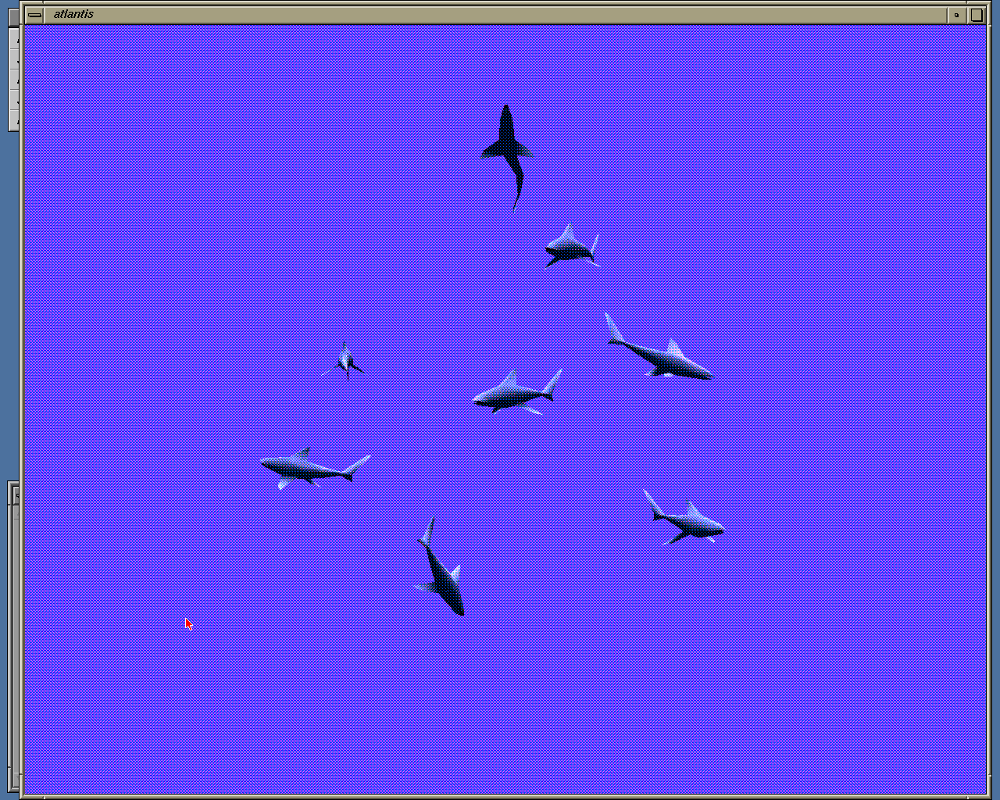

# SGIEmu — a fast Silicon Graphics Indy emulator

SGIEmu emulates the SGI **Indy** workstation (IP24, R4400, Newport XL
graphics) well enough to run **IRIX 5.3 and IRIX 6.5** up to the Indigo
Magic desktop, with OpenGL/IRIS GL demos, in real time on a PC. It aims to be
**fast** rather than cycle-exact: a JIT translates MIPS code to x86-64, and a
whole IRIX 5.3 boot takes a few seconds when the speed is not capped.



| PROM | Login | Desktop |
|---|---|---|
|  |  |  |

*Not affiliated with or endorsed by Silicon Graphics or Hewlett Packard
Enterprise. SGI, Indy, IRIX and the SGI cube logo are trademarks of their
respective owners.*

## Download

Windows 64-bit, portable (unzip and run):
[**Releases page**](https://github.com/RenatoTarabella/SGIEmu/releases).

The zip contains `indy.exe` (the emulator window), `indy_boot.exe` (headless,
for testing and scripting), `mkdisk.exe` (creates an empty disk image) and
empty `roms\`, `disks\` and `cdrom\` folders.

**No ROMs or software are included.** You need your own Indy PROM and IRIX
disk or CD images (see below).

## Getting started

1. **PROM.** Copy the Indy boot PROM into `roms\ip24prom.bin`. The tested one
   is `ip24prom.070-9101-011.bin` (512 KB), the PROM of the R4x00 Indy, as
   dumped from a real machine or found in MAME's `indy_4610` ROM set.
2. **Disk.** Put a raw SCSI disk image with IRIX installed in `disks\`. If
   you used IRIX in MAME you already have one as a CHD; convert it with
   MAME's `chdman`:
   ```
   chdman extracthd -i irix65.chd -o disks\irix65.img
   ```
   The image is a plain file with the SGI volume header, as on a real disk.
   **IRIX writes to it**: keep a backup copy.
3. **Start** `indy.exe`. A dialog asks for the PROM, NVRAM, up to two disks
   (SCSI IDs 1 and 2), a CD-ROM (SCSI ID 4), memory, graphics board and CPU
   speed, and remembers the choices in `indy.ini`. Suggested memory: 64 MB
   for IRIX 5.3, 128 MB for IRIX 6.5.

On the first start there is no NVRAM yet: the PROM prints *"NVRAM checksum
is incorrect: reinitializing"*, creates a default environment and boots IRIX
from the first disk. The NVRAM (PROM environment and clock) is saved on exit
in `roms\nvram\indy.nvram`. To reach the PROM menu instead, press **Esc**
during the "Starting up the system" countdown (Stop for Maintenance).

In the window:

- click to capture the mouse, **Ctrl+F11** releases it;
- the keyboard is passed through by physical key (PS/2 scan codes). IRIX
  assumes a US layout; for another one, as root run `nvram keybd XX`
  (`DE`, `FR`, `IT`, `ES`, `GB`, ...) and reboot;
- the serial console (port 1) is printed in the terminal `indy.exe` was
  started from, if any;
- shut IRIX down cleanly (System > System Shutdown, or `shutdown -y -g0`
  as root) before closing the window, as on the real machine: closing it
  is like pulling the plug and the next boot will run `fsck`.

Command-line start without the dialog:
```
indy.exe --prom roms\ip24prom.bin --disk disks\irix65.img [--disk SECOND.img]
         [--cdrom CD.iso] [--ram 128] [--gfx 8|24] [--mips N] [--nojit]
```

### CD-ROMs

IRIX CDs work as plain `.iso` files (2048-byte sectors) and as the raw
`.bin` files (2352-byte MODE1 sectors) that `chdman extractcd` writes from a
MAME CD CHD:
```
chdman extractcd -i irix53.chd -o cdrom\irix53.cue -ob cdrom\irix53.bin
```
IRIX mounts the CD automatically on `/CDROM`; software can be installed
with `inst` (for example `inst -f /CDROM/dist`) or the Software Manager.

### An empty disk

```
mkdisk disks\new.img 2048
```
creates an empty 2 GB disk. IRIX sees it (`hinv`) but it has no volume
header yet: label and partition it with `fx` before use. A fresh IRIX
installation from CD onto an empty disk (booting `fx` and the miniroot from
the CD) **has not been tested yet**; the tested path is a disk already
installed, for example converted from MAME.

## What works

- R4400 CPU: MIPS III, 32/64-bit, TLB, precise exceptions, FPU, caches as
  far as IRIX needs; JIT to x86-64 (interpreter fallback with `--nojit`).
- PROM: power-on diagnostics, graphical and serial System Maintenance Menu,
  Command Monitor, boot from disk and CD.
- IRIX 5.3 and IRIX 6.5: multi-user, X11, Indigo Magic desktop, graphical
  login, serial console login, clean shutdown and power off.
- Newport graphics, XL8 (default) and XL24 (`--gfx 24`, less tested): 2D
  acceleration, colour maps, DID tables, cursor, popup planes, double
  buffering. IRIS GL demos such as buttonfly, atlantis, flight, ideas, blast.
- SCSI disks and CD-ROM, PS/2 keyboard and mouse, serial ports, real-time
  clock with NVRAM, timers and interrupts.

## Not yet

- **Network** (Seeq Ethernet) and **audio** (HAL2): not emulated. IRIX
  reports no audio hardware and the network interface does not work.
- Indigo2 and other SGI machines (the next planned step), R5000/R4600 CPUs.
- Known graphics glitches: the "textured cube" demo shows horizontal smears
  (VDMA/pixel zoom not implemented), black areas while moving through
  popup menus, overlay planes, stipples and blending barely tested.
- `hinv` reports a 128 KB secondary cache instead of 1 MB.
- Windows only for now.

Bug reports are welcome on the
[issues page](https://github.com/RenatoTarabella/SGIEmu/issues): please
say which IRIX version, memory size and graphics board you used, and what
the serial console printed.

## Building from source

Windows, Visual Studio 2022 and CMake:
```
cmake -S . -B build -G "Visual Studio 17 2022" -A x64
cmake --build build --config Release
build\Release\test_r4k.exe                    # CPU unit tests (TLB, exceptions, FPU...)
build\Release\test_devices.exe                # the Indy chips one by one
.venv\Scripts\python tests\diff_unicorn.py    # differential test against Unicorn
build\Release\test_r4k.exe --bench            # interpreter speed
set R4K_JIT=64                                # the same tests and benchmark with the JIT
```

The differential test needs a Python virtual environment with Unicorn:
`python -m venv .venv` then `.venv\Scripts\pip install unicorn==2.1.4`.

`indy_boot.exe` runs the machine headless: serial console on stdout,
`--keys` typed on the serial port or (`--kbd`) on the PS/2 keyboard, `--png`
saves the screen, `--snapshot` keeps disk writes in memory, and many
tracing options. `CLAUDE.md` is the developer guide (design, hardware notes,
test workflow); source comments are in Italian.

How it is built: the CPU is an interpreter plus a JIT whose blocks are
indexed by physical address (they survive TLB and ASID changes), with
inline fast-MMU loads/stores, direct block chaining and a jump cache. It
executes exactly the same instructions as the interpreter: IRIX 5.3 and 6.5
boots give bit-identical results with and without it. The chips (MC, HPC3,
IOC/INT3, 8254, Z85C30, DS1386, 93CS56, 8042, WD33C93, Newport REX3/VC2/
XMAP9/CMAP) are separate modules, each with its own tests.

## License

MIT, see `LICENSE`. MAME, GXemul, Linux and NetBSD sources were used only as
documentation of hardware behaviour; no code is copied from them. The Indy
PROM, IRIX and all SGI software are copyrighted by their owners and are not
distributed here.
