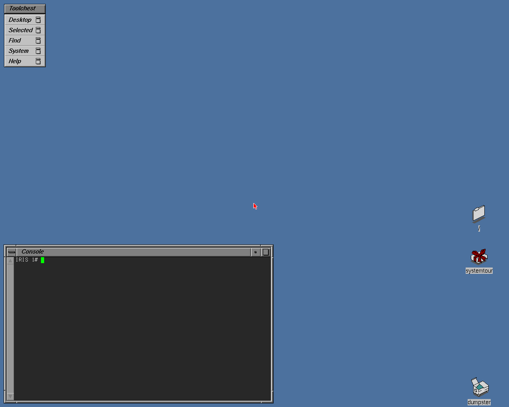
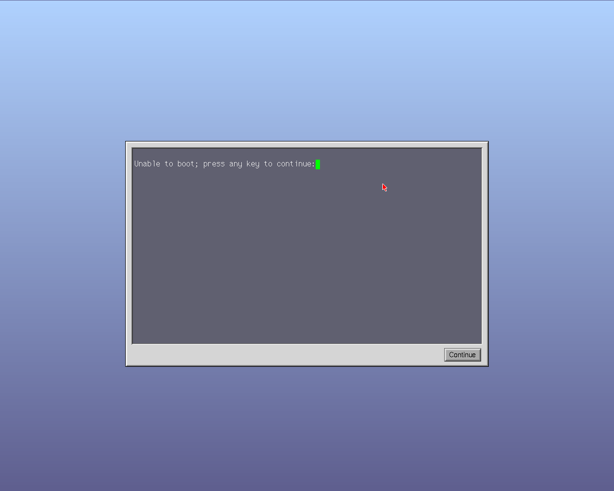
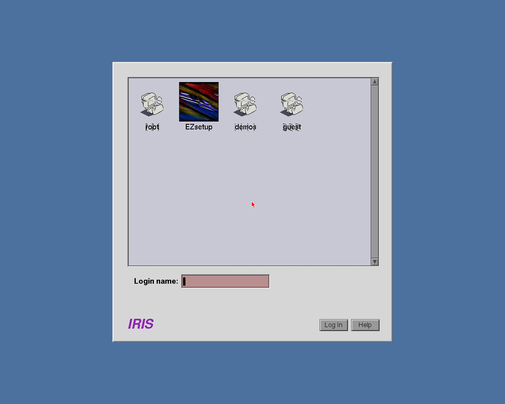

# SGI emulator (Indy / IP24)

An emulator for the Silicon Graphics Indy workstation aimed at running IRIX
**fast** rather than cycle-exact. Written in C99, built with MSVC 2022 and CMake.

Status: **IRIX 5.3 boots to the Indigo Magic desktop.** The Indy PROM runs
its diagnostics and graphical interface on the emulated Newport (XL8) board,
loads `sash` and the kernel from an emulated SCSI disk, and IRIX comes up with
the X server, the graphical login and the desktop, in real time.



| PROM | Login |
|---|---|
|  |  |

Emulated: the R4400 CPU (below), the MC memory controller (RAM banks, RPSS,
VDMA), HPC3 with SCSI DMA, IOC with INT3 interrupts and the 8254 timer, the
Z85C30 serial port, the DS1386 clock with the NVRAM environment, the 8042
keyboard/mouse controller, the 93CS56 EEPROM, the WD33C93 SCSI controllers,
SCSI disks / CD-ROMs on image files, and the Newport graphics (REX3 drawing
engine, VC2 with cursor and DID tables, CMAP, XMAP9, BT445).

The CPU:

- MIPS III interpreter, 32/64 bit, big-endian
- CP0: 48-entry TLB with page sizes from 4 KB to 16 MB, ASIDs, global entries,
  Random/Wired, precise exceptions with branch-delay slots (EPC, Cause.BD),
  TLB refill and XTLB refill vectors, Count/Compare, external interrupts
- FPU (CP1): single, double, word and long formats, FR=0/1 register layouts,
  rounding modes, IEEE flags/causes/enables, MIPS "legacy" NaNs
- CACHE instruction (tag arrays for the index operations, used by the PROM
  and by kernels to size the caches)
- a fast MMU (virtual page → host pointer, per privilege mode)
- a JIT to x86-64: blocks indexed by physical address (they survive TLB and
  ASID changes), inline fast-MMU loads/stores, direct block chaining and a
  jump cache for register jumps; uncommon instructions call the interpreter.
  It executes exactly the same instructions as the interpreter (same
  instruction counts, exceptions and interrupts at the same points): IRIX 5.3
  and 6.5 boots give bit-identical results with and without it.

Booting IRIX 5.3 to a root shell (215 s of emulated time) takes about 8 s
with the JIT and 100 s with the plain interpreter (~200 MIPS, twice a
100 MHz Indy). The window runs at real time; `--mips N` sets the emulated
CPU speed.

## Running it

```
build\Release\indy.exe [--prom roms\ip24prom.bin] [--disk disks\irix53.img] [--cdrom cdrom\x.iso]
                       [--mips N] [--nojit]
```

Without arguments a start dialog asks for the PROM, NVRAM, disks, CD-ROM,
memory, graphics board (XL8/XL24), CPU speed and JIT, remembering the last
choices in `indy.ini` next to the executable (the first time it looks for
`roms\ip24prom.bin` and `disks\irix53.img`). With arguments it starts
directly.
Click in the window to capture the mouse, Ctrl+F11 releases it. The keyboard
is passed through by physical key (PS/2 scan codes): choose the layout in
IRIX. The serial console is printed in the terminal that started the program.
The NVRAM (clock and PROM environment) is saved in `roms\nvram\indy.nvram`.

## Build and test

```
cmake -S . -B build -G "Visual Studio 17 2022" -A x64
cmake --build build --config Release
build\Release\test_r4k.exe                    # CPU unit tests (TLB, exceptions, FPU...)
build\Release\test_devices.exe                # the Indy chips one by one
.venv\Scripts\python tests\diff_unicorn.py    # differential test against Unicorn
build\Release\test_r4k.exe --bench            # interpreter speed
set R4K_JIT=64                                # the same tests and benchmark with the JIT
```

The differential test needs a Python virtual environment with Unicorn:
`python -m venv .venv` then `.venv\Scripts\pip install unicorn==2.1.4`.

`build\Release\indy_boot.exe` runs the machine headless: serial console on
stdout, `--keys` typed on the serial port or (`--kbd`) on the PS/2 keyboard,
`--png` saves the screen, and many tracing options (see `CLAUDE.md`).

## ROMs and IRIX media

The Indy PROM, disk images and IRIX CDs are copyrighted and are **not** part
of this repository. Put them in `roms/`, `disks/` and `cdrom/` (git-ignored).

## License

MIT, see `LICENSE`. MAME, GXemul, Linux and NetBSD sources were used only as
documentation of hardware behaviour; no code is copied from them.
